# Tài liệu kiến trúc – Bài tập tuần 7

Một codebase duy nhất phát triển qua 4 phiên bản. Mỗi phiên bản có commit và tag riêng (`v2`, `v3`, `v4`).

## Mục lục

| File | Nội dung |
|---|---|
| [`V2-client-server.md`](V2-client-server.md) | Sơ đồ kiến trúc V2, nhật ký, đánh đổi |
| [`V3-n-layer.md`](V3-n-layer.md) | Sơ đồ 3 lớp V3, file đổi khi thay UI / thay DB |
| [`V4-p2p.md`](V4-p2p.md) | Sơ đồ thành phần + luồng kết nối P2P, đánh đổi, trả lời câu hỏi thảo luận |
| [`agent-log.md`](agent-log.md) | Prompt chính và lỗi phát sinh khi dùng coding agent |
| `screenshots/` | Ảnh minh chứng kiểm thử từng phiên bản |

## Bảng nhật ký quyết định

| Version | NFR mới | Quyết định thiết kế | File/thành phần đổi | Kết quả test |
|---|---|---|---|---|
| V1 | Chưa có (chỉ chức năng: tạo, xem, đổi trạng thái, xoá; dữ liệu còn sau khi restart) | Express + 1 trang HTML, lưu `tasks.json` | `server.js`, `public/index.html`, `tasks.json` | Gọi API tạo 2 task ("Hoc bai kien truc", "Nop bai tuan 7"), gọi API hoàn thành 1 task, tắt server và khởi động lại → giao diện hiển thị đúng 2 task và trạng thái hoàn thành vẫn còn nguyên trong `tasks.json` ✅ |
| V2 | Chia sẻ trạng thái tập trung giữa nhiều client | Giữ server, client polling 2s; đặt trạng thái `{done}` thay toggle; id duy nhất (UUID sinh bởi `crypto.randomUUID` thay `Date.now`, dữ liệu cũ giữ nguyên `task-1`, `task-2`); ghi file atomic; listen `0.0.0.0` | `server.js`, `public/index.html` | A tạo → B thấy không reload; B đánh dấu xong → A thấy; tắt server → client báo mất kết nối ✅ |
| V3 | Modifiability: thay UI và persistence | Tách Presentation / Business / Data Access; `ITaskRepository`; Kanban 2 cột; SQLite + migration từ JSON | `src/**`, `scripts/migrate-to-sqlite.js`, `server.js`, `public/index.html` | Chạy server tự động migrate 2 task từ `tasks.json` sang SQLite (`tasks.db`), giao diện Kanban 2 cột hiển thị đủ; gọi API tạo task mới và đổi trạng thái; tắt server bật lại vẫn giữ nguyên; chạy lại migrate lần 2 không bị nhân đôi task ✅ |
| V4 | Availability khi mất server; giao tiếp ngang hàng | Giữ V3 làm chế độ thường; thêm WebRTC DataChannel (signaling copy-paste); bản sao cục bộ; snapshot + op, last-write-wins | `public/js/peer-link.js`, `public/js/local-replica.js`, `public/index.html` (server không đổi) | Kết nối A–B, tắt server; A tạo → B nhận; đổi trạng thái XONG → cả hai đổi cột ✅ |

## Kiến trúc qua từng phiên bản

| | V1 | V2 | V3 | V4 |
|---|---|---|---|---|
| Kiểu kiến trúc | Ứng dụng web 1 máy | Client–Server | Client–Server + N-Layer | Client–Server + N-Layer + đường P2P |
| Dữ liệu nằm ở | `tasks.json` | `tasks.json` trên server | `tasks.db` (SQLite) | SQLite (thường) / bản sao trên mỗi peer (P2P) |
| Tắt server thì | Không dùng được | Không dùng được | Không dùng được | Vẫn đồng bộ được giữa 2 peer đã kết nối |

## Điều đã học

- Thiết kế V1 chỉ đủ cho 1 người 1 máy; mỗi NFR mới (nhiều client, dễ thay thế, chịu được mất server) buộc phải đổi kiến trúc.
- Client–Server, N-Layer và P2P không loại trừ nhau: V4 vẫn giữ nguyên V3, chỉ thêm một đường đồng bộ.
- Đổi lấy availability ở V4 là mất nhất quán mạnh: không còn một nguồn dữ liệu chuẩn, xung đột chỉ xử lý thô.

## Ảnh minh chứng kiểm thử (Screenshots)

> **Ghi chú về kiểm thử tự động:** Các thao tác tạo task và cập nhật trạng thái ở V1 và V3 được thực hiện bằng lệnh gọi HTTP API (`curl`), sau đó chụp màn hình trình duyệt để kiểm chứng kết quả hiển thị thực tế (không phải bấm chuột thủ công trên UI). Các ảnh terminal (`v1-3-tasks-json.png`, `v3-1-truoc-migrate.png`, `v3-2b-log-migrate.png`, `v3-5-migrate-lan-2.png`, `v3-6-file-thay-doi.png`, `v3-7-tach-lop.png`) được render từ output thật của lệnh qua trang HTML (vì môi trường chạy tự động không chụp trực tiếp được cửa sổ terminal hệ điều hành).

### Version 1 – Đơn máy, lưu tasks.json
- 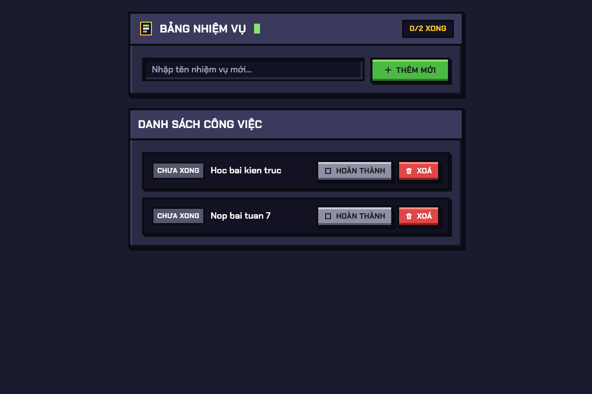
  *Gọi API tạo thành công 2 task ("Hoc bai kien truc", "Nop bai tuan 7"), giao diện V1 hiển thị đủ 2 task kèm đếm 0/2 XONG.*
- 
  *Gọi API đánh dấu hoàn thành task "Hoc bai kien truc", giao diện V1 cập nhật task sang trạng thái gạch ngang và đếm 1/2 XONG.*
- 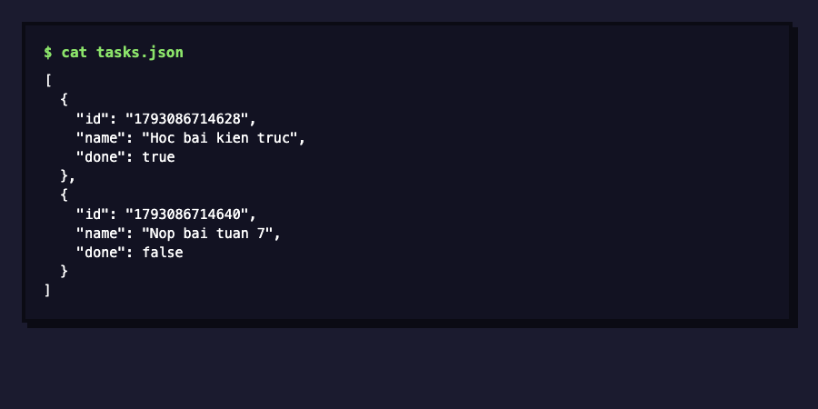
  *File `tasks.json` ghi nhận đúng 2 task với trạng thái `done: true` và `done: false`.*
- 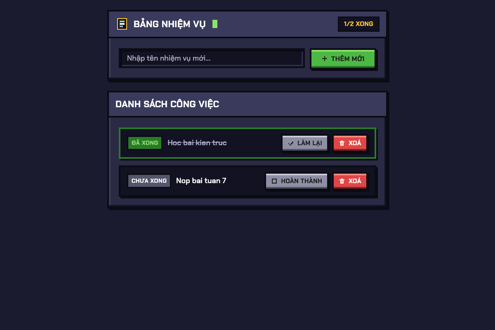
  *Tắt server, khởi động lại và tải lại trang, 2 task và trạng thái hoàn thành vẫn giữ nguyên.*

### Version 2 – Client–Server nhiều client
- 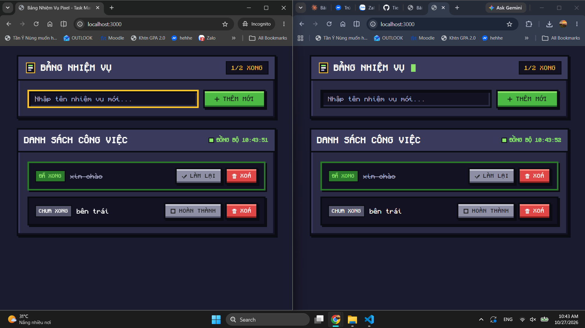
  *Hai cửa sổ trình duyệt (thường và ẩn danh) cùng kết nối, client A tạo task thì client B tự động cập nhật qua polling.*
- 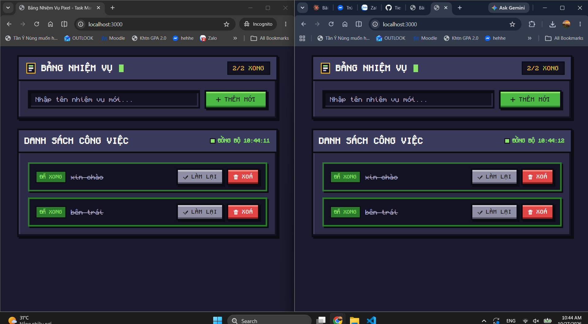
  *Hai cửa sổ trình duyệt (Incognito bên trái và thường bên phải) hiển thị đồng bộ 2 task ("xin chào", "bên trái") đều ở trạng thái ĐÃ XONG (gạch ngang, nút LÀM LẠI), bộ đếm 2/2 XONG và nhãn trạng thái ĐỒNG BỘ.*
- 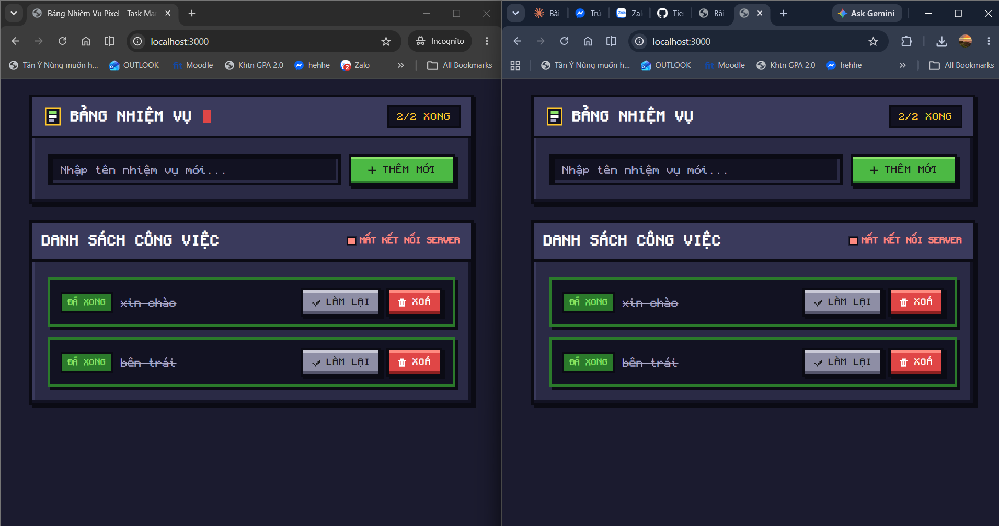
  *Khi tắt server, cả hai client đồng loạt hiển thị nhãn màu cam/đỏ MẤT KẾT NỐI SERVER ở góc trên danh sách công việc.*

### Version 3 – Bảng Kanban + SQLite + Tách lớp
- 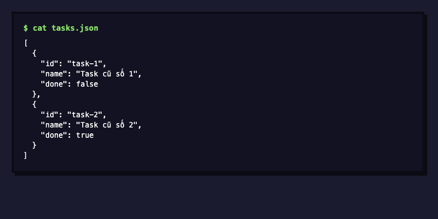
  *File `tasks.json` cũ từ V2 chứa 2 task trước khi khởi động server V3.*
- 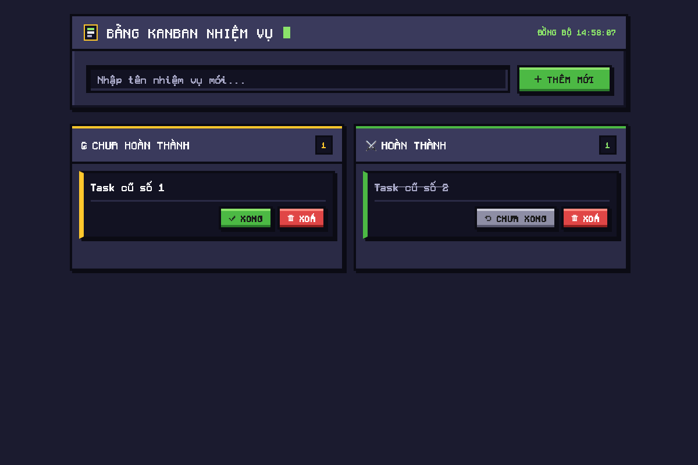
  *Giao diện Kanban 2 cột sau khi khởi động, nạp thành công 2 task cũ vào đúng cột Chưa hoàn thành và Hoàn thành.*
- 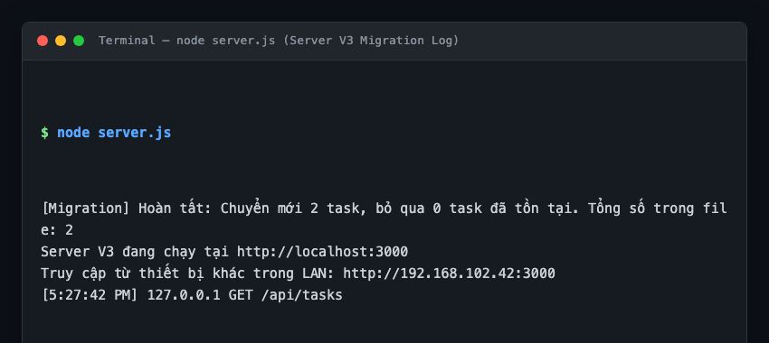
  *Log terminal khởi động server ghi nhận output thật của script migration tự động chuyển 2 task cũ từ `tasks.json` sang SQLite.*
- 
  *Gọi API tạo task mới ("Task moi Kanban V3") và gọi API chuyển trạng thái task cũ sang hoàn thành, giao diện Kanban 2 cột cập nhật vị trí các task tương ứng.*
- 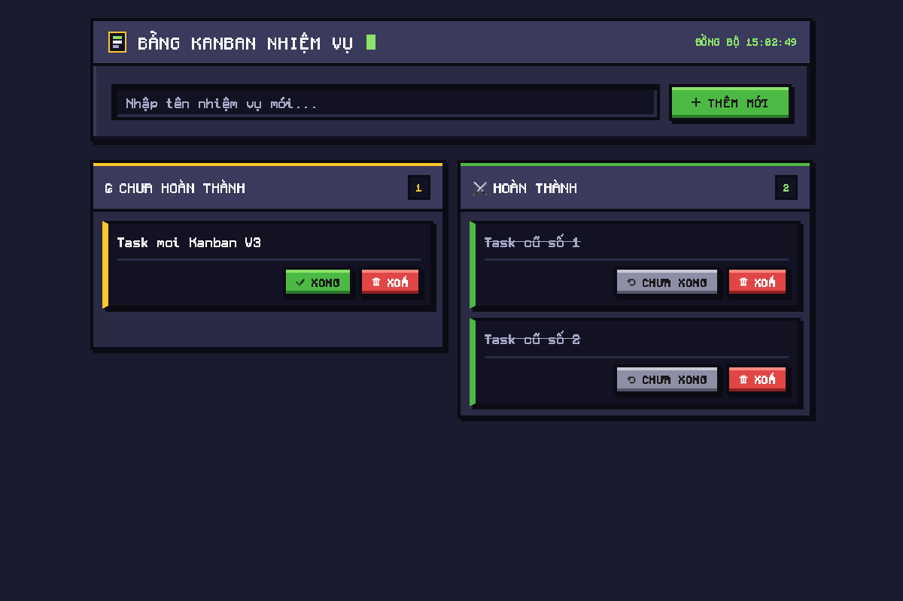
  *Tắt server, bật lại và reload trình duyệt, cả 3 task vẫn được lưu trữ nguyên vẹn trong SQLite (`tasks.db`).*
- 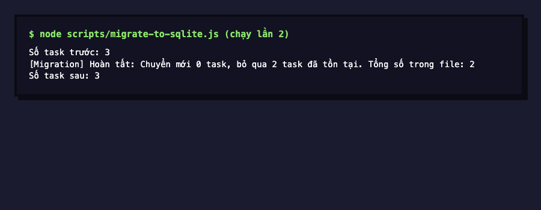
  *Chạy lại migration độc lập lần 2 qua terminal: số task giữ nguyên 3 task, bỏ qua toàn bộ task cũ, không bị nhân đôi dữ liệu.*
- 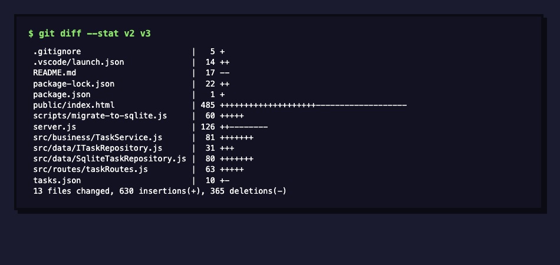
  *Lệnh `git diff --stat v2 v3` chỉ ra chi tiết các file thay đổi khi chuyển giao diện Kanban và cấu trúc 3 lớp.*
- 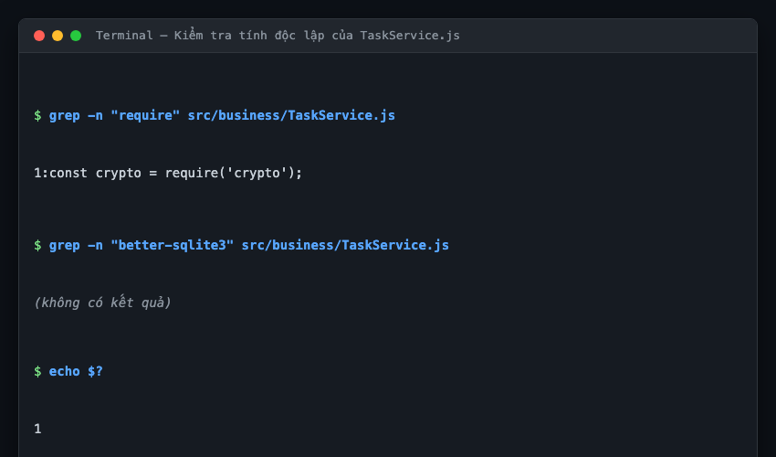
  *Lệnh grep kiểm tra `TaskService.js` chứng minh tầng nghiệp vụ hoàn toàn không import `better-sqlite3` hay `express`. Lệnh chỉ trả về `require('crypto')` - module chuẩn tích hợp sẵn của Node.js để sinh UUID.*

### Version 4 – Đồng bộ P2P khi mất server
- 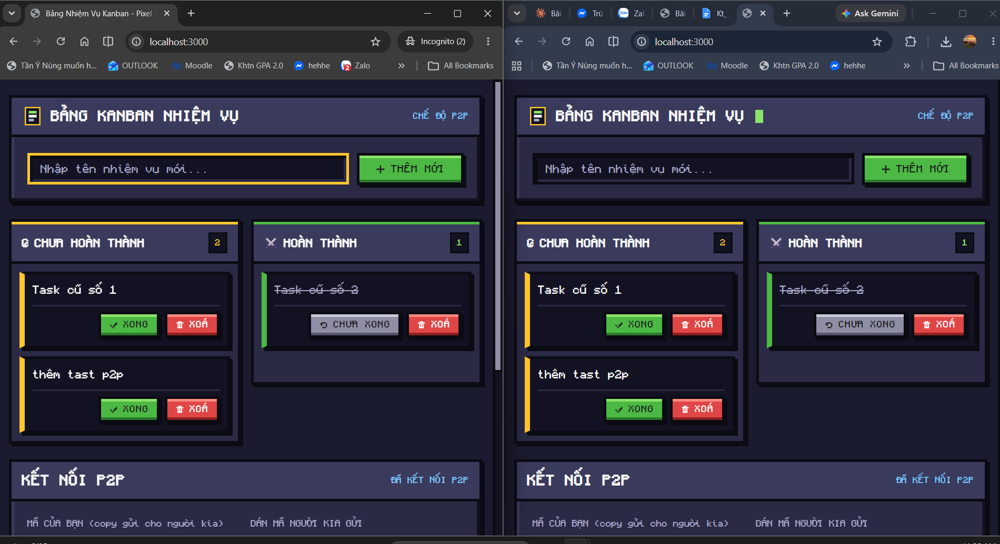
  *Hai trình duyệt kết nối WebRTC DataChannel thành công bằng mã mời thủ công, cả hai đều hiển thị nhãn "CHẾ ĐỘ P2P" và khung kết nối hiển thị "ĐÃ KẾT NỐI P2P", danh sách task Kanban đồng bộ.*
- 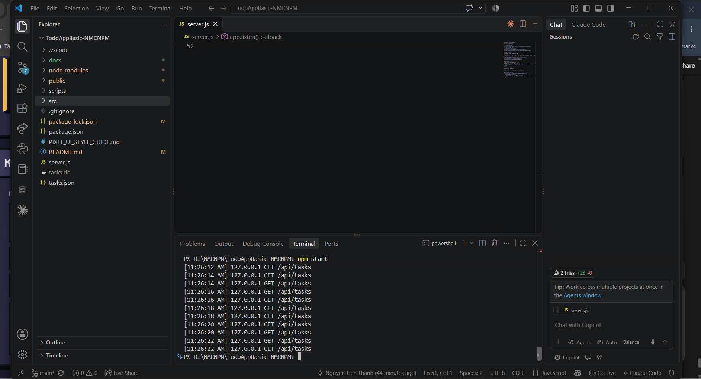
  *Server Node.js đã bị tắt ở cửa sổ terminal, nhưng kết nối P2P giữa hai trình duyệt vẫn duy trì trực tiếp.*
- 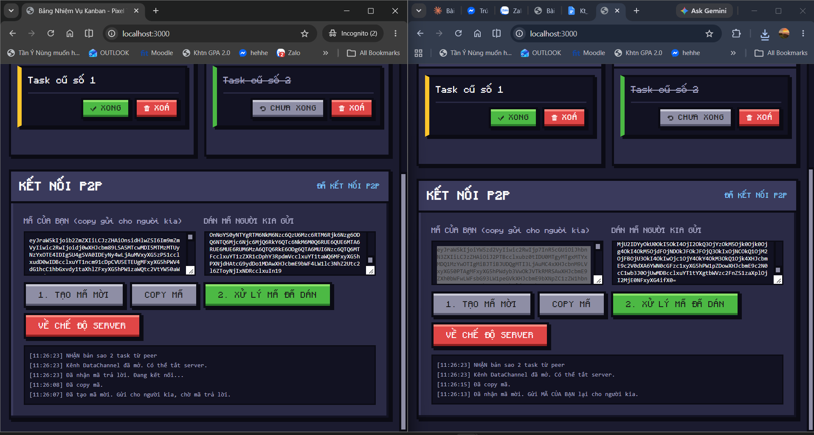
  *Server đã tắt, peer A tạo task mới và gửi thẳng qua WebRTC DataChannel tới peer B tức thì.*
- 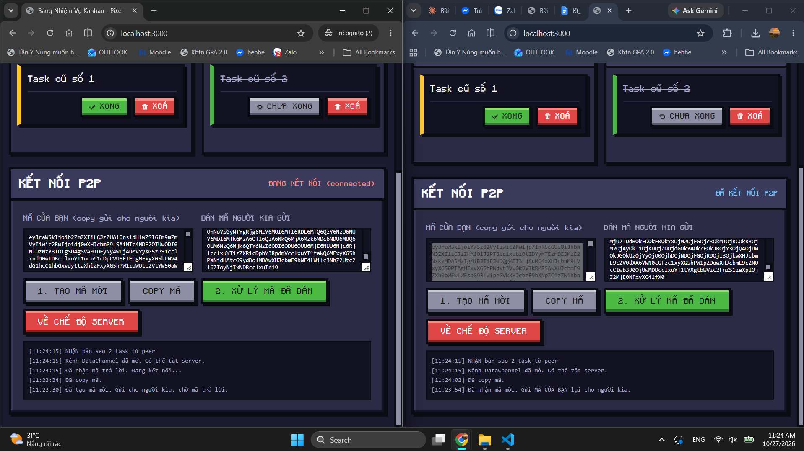
  *Khung kết nối P2P của hai trình duyệt sau khi kết nối và trao đổi bản sao snapshot 2 task ("Task cũ số 1", "Task cũ số 2"), khung log hiển thị dòng nhận bản sao và thông báo DataChannel đã mở.*

## Trả lời câu hỏi thảo luận

### 1. Nâng V1 lên V2 thay đổi gì về cách dùng/triển khai (không chỉ đổi tên kiến trúc)?
Ở V1, ứng dụng chỉ dùng cục bộ trên 1 máy (`localhost`), dữ liệu nạp một lần duy nhất lúc mở trang nên nếu mở nhiều tab hoặc nhiều người cùng dùng sẽ không thấy thay đổi của nhau nếu không reload trang. Lên V2, server lắng nghe trên tất cả giao diện mạng (`0.0.0.0`) giúp các máy khác trong mạng LAN có thể kết nối vào qua IP thật. Phía client được bổ sung cơ chế polling định kỳ 2 giây/lần để liên tục đồng bộ dữ liệu mới nhất từ server. Đồng thời, API cập nhật trạng thái đổi từ cơ chế lật ngược (toggle) sang gửi trạng thái cụ thể (`done: true/false`) kèm ID định danh duy nhất (dữ liệu cũ dùng id `task-1`, `task-2`; từ V2 server sinh UUID bằng `crypto.randomUUID()` thay cho `Date.now()` để tránh trùng khi 2 máy tạo cùng mili-giây), ngăn chặn việc hai client thao tác cùng lúc làm đảo lộn trạng thái của nhau.

### 2. Ở V3, phần nào đổi khi thiết kế lại UI, phần nào đổi khi chuyển JSON sang SQLite? Bằng chứng tách biệt là gì?
Khi thiết kế lại giao diện sang bảng Kanban 2 cột, chỉ có duy nhất file [`public/index.html`](file:///Users/macos/Desktop/TodoProject/public/index.html) bị sửa đổi để render 2 cột và xử lý hiển thị trạng thái. Khi chuyển từ file JSON sang SQLite, các file thay đổi gồm [`src/data/SqliteTaskRepository.js`](file:///Users/macos/Desktop/TodoProject/src/data/SqliteTaskRepository.js), script [`scripts/migrate-to-sqlite.js`](file:///Users/macos/Desktop/TodoProject/scripts/migrate-to-sqlite.js), thư viện `better-sqlite3` trong `package.json`, và 1 dòng khởi tạo repository trong `server.js`. Bằng chứng tách biệt rõ ràng được thể hiện qua output `git diff --stat v2 v3` ([ảnh v3-6](screenshots/v3-6-file-thay-doi.png)) và lệnh grep ([ảnh v3-7](screenshots/v3-7-tach-lop.png)): tầng Business Logic ([`TaskService.js`](file:///Users/macos/Desktop/TodoProject/src/business/TaskService.js)) hoàn toàn không bị ảnh hưởng bởi giao diện Kanban và cũng không hề import thư viện SQLite hay Express; `TaskService.js` chỉ require duy nhất module `crypto` chuẩn của Node.js để sinh UUID.

### 3. V4 cải thiện tính sẵn sàng ở tình huống nào? Đổi lại mất bảo đảm gì về đồng bộ và nhất quán?
V4 cải thiện tính sẵn sàng (Availability) khi server trung tâm gặp sự cố hoặc bị tắt hoàn toàn, nhưng hai máy người dùng trong cùng mạng LAN đã kịp kết nối P2P trực tiếp với nhau từ trước thông qua WebRTC DataChannel. Trong tình huống này, hai peer vẫn có thể tiếp tục tạo task, đổi trạng thái và xoá task trực tiếp với nhau mà không bị gián đoạn. Tuy nhiên, hệ thống phải đánh đổi bằng việc mất đi tính nhất quán mạnh (Strong Consistency) và không còn một nguồn dữ liệu chuẩn duy nhất (Single Source of Truth). Vì V4 chưa giải quyết xung đột đầy đủ, xung đột chỉ được xử lý thô bằng cơ chế Last-Write-Wins dựa trên `updatedAt` của đồng hồ máy tính (dễ sai lệch nếu giờ 2 máy không chuẩn), và dữ liệu thao tác lúc P2P không tự động ghi ngược về SQLite trên server.

### 4. Khi nào server LAN đơn giản hợp lý hơn P2P?
Mô hình Server LAN tập trung đơn giản và hợp lý hơn khi nhóm làm việc có từ 3 thành viên trở lên, vì mô hình P2P dạng lưới (full-mesh) rất phức tạp để thiết lập kết nối và duy trì đồng bộ giữa nhiều bên. Ngoài ra, khi ứng dụng đòi hỏi dữ liệu phải được lưu trữ bền vững, tập trung, dễ sao lưu và bảo mật trên ổ đĩa máy chủ, kiến trúc Client–Server là lựa chọn vượt trội. Server LAN cũng loại bỏ hoàn toàn rủi ro xung đột dữ liệu cục bộ hay hiện tượng task bị xoá lại xuất hiện lại (do thiếu tombstone), đồng thời không gặp trở ngại khi mạng nội bộ chặn kết nối ngang hàng WebRTC.
