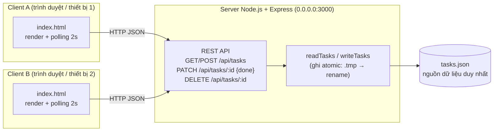

# V2 – Client–Server (nhiều client dùng chung dữ liệu)

**Ràng buộc mới:** hai người trên hai thiết bị/trình duyệt phải thấy thay đổi của nhau.
**Hạn chế của V1:** server chỉ nghe được ổn định trên máy chạy nó, client chỉ tải dữ liệu 1 lần lúc mở trang, và thao tác "toggle" lật trạng thái nên có thể đè lên thay đổi của người khác.

## Sơ đồ kiến trúc

Dữ liệu chỉ nằm ở server (`tasks.json`). Client không lưu bản sao lâu dài; tắt server thì client không tạo/xem/sửa/xoá được và hiển thị "MẤT KẾT NỐI SERVER".

## Nhật ký V2

| Version | NFR mới | Quyết định thiết kế | File/thành phần đổi | Kết quả test |
|---|---|---|---|---|
| V2 | Chia sẻ trạng thái tập trung giữa nhiều client | Giữ server V1, mọi client đọc/ghi qua API; polling 2s; đặt trạng thái tường minh `{done}` thay cho toggle; id UUID; ghi file atomic; listen 0.0.0.0 để máy khác trong LAN vào được | `server.js`, `public/index.html` | A tạo 2 task → B thấy sau ≤2s không reload; B đánh dấu xong → A thấy `1/2 XONG`; tắt server → client báo mất kết nối |

## Đánh đổi

- Polling đơn giản, không cần WebSocket, nhưng có độ trễ tới 2s và tốn request khi không có thay đổi.
- Server là điểm lỗi duy nhất: tắt server là mất toàn bộ chức năng (động lực cho V4).
- Đọc/ghi lại cả file JSON mỗi request: ổn với dữ liệu nhỏ, không mở rộng được (động lực cho SQLite ở V3).
