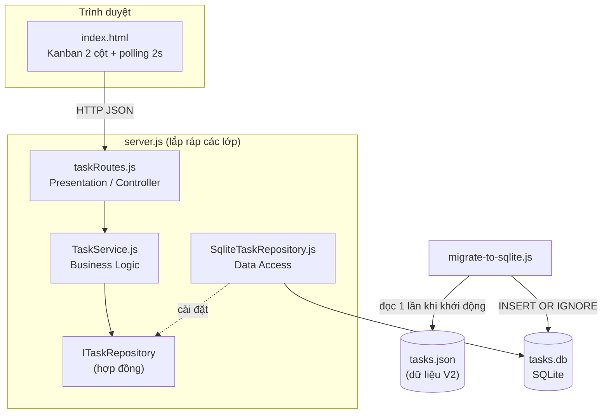

# V3 – Đổi giao diện và nguồn lưu trữ (N-Layer)

**Ràng buộc mới:** thay danh sách bằng bảng Kanban 2 cột (Chưa hoàn thành / Hoàn thành) và thay `tasks.json` bằng SQLite, không mất task cũ.
**Hạn chế của thiết kế hiện tại (V2):** `server.js` trộn chung định tuyến HTTP, quy tắc nghiệp vụ và đọc/ghi file JSON, nên đổi nơi lưu trữ phải sửa lẫn vào code xử lý request.

## Kiến trúc 3 lớp

| Lớp | File | Trách nhiệm | Biết về |
|---|---|---|---|
| Presentation (View) | `public/index.html` | Vẽ Kanban, gọi API | HTTP API |
| Presentation (Controller) | `src/routes/taskRoutes.js` | Nhận request, gọi service, trả JSON + status code | Express, TaskService |
| Business Logic | `src/business/TaskService.js` | Kiểm tra tên rỗng, tạo id/done, đổi trạng thái, báo lỗi 400/404 | Chỉ interface repository |
| Data Access | `src/data/ITaskRepository.js` | Hợp đồng: `getAll / getById / create / update / delete` | — |
| Data Access | `src/data/SqliteTaskRepository.js` | Cài đặt hợp đồng bằng SQLite (`tasks.db`) | better-sqlite3 |
| Migration | `scripts/migrate-to-sqlite.js` | Chuyển `tasks.json` sang SQLite, chạy tự động khi server khởi động | SqliteTaskRepository |
| Composition root | `server.js` | Lắp ráp: Repo → Service → Router | Tất cả |

## File thay đổi theo từng yêu cầu

| Yêu cầu | File đổi | File **không** đổi |
|---|---|---|
| Đổi UI sang Kanban | `public/index.html` | `src/business/`, `src/data/`, `src/routes/` |
| Đổi JSON sang SQLite | `src/data/SqliteTaskRepository.js`, `scripts/migrate-to-sqlite.js`, phần khởi tạo trong `server.js`, `package.json` (thêm better-sqlite3) | `public/index.html`, `src/business/TaskService.js` |

**Đổi SQLite sang nguồn khác** (MongoDB, file...): viết một lớp mới cài đặt `ITaskRepository` và đổi 1 dòng khởi tạo trong `server.js`. `TaskService` và giao diện không đổi.

**Tầng nghiệp vụ có cần biết Kanban không?** Không. `TaskService` chỉ biết task có `done` đúng hay sai; việc chia thành 2 cột là việc của giao diện.

## Nhật ký V3

| Version | NFR mới | Quyết định thiết kế | File/thành phần đổi | Kết quả test |
|---|---|---|---|---|
| V3 | Modifiability: thay UI và persistence mà nghiệp vụ vẫn chạy | Tách 3 lớp, dependency injection Repo → Service → Router; repository interface; migration idempotent (`INSERT OR IGNORE`) chạy lúc khởi động | `server.js`, `src/**`, `scripts/migrate-to-sqlite.js`, `public/index.html`, `package.json` | _(nhóm V3 điền: task V2 còn sau migrate, CRUD trên Kanban, restart vẫn giữ dữ liệu)_ |

## Đánh đổi

- Nhiều file và nhiều lớp hơn cho một ứng dụng nhỏ, đổi lại thay thế từng phần dễ và có bằng chứng tách biệt.
- SQLite cần thư viện native (better-sqlite3) nên máy mới phải `npm install` đúng môi trường.
- Migration chạy mỗi lần khởi động: an toàn nhờ `INSERT OR IGNORE`, nhưng task đã xoá trong SQLite sẽ quay lại nếu `tasks.json` vẫn còn chứa nó.
