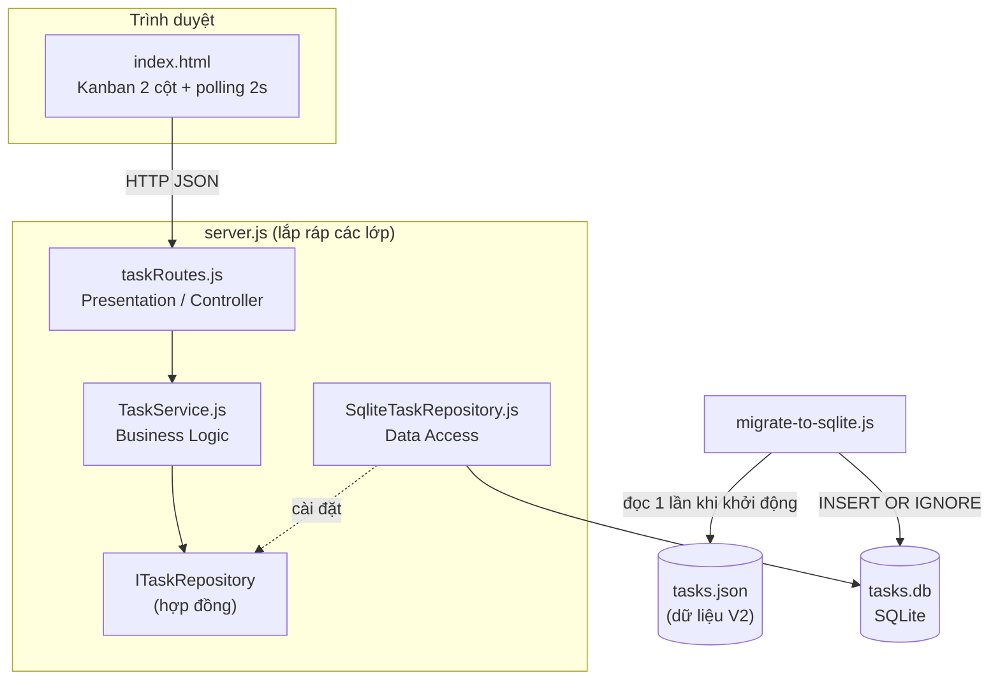

# V3 – Đổi giao diện và nguồn lưu trữ (N-Layer)

**Ràng buộc mới:** thay danh sách bằng bảng Kanban 2 cột (Chưa hoàn thành / Hoàn thành) và thay `tasks.json` bằng SQLite, không mất task cũ.
**Hạn chế của thiết kế hiện tại (V2):** `server.js` trộn chung định tuyến HTTP, quy tắc nghiệp vụ và đọc/ghi file JSON, nên đổi nơi lưu trữ phải sửa lẫn vào code xử lý request.

## Kiến trúc 3 lớp

| Lớp | File | Trách nhiệm | Biết về |
|---|---|---|---|
| Presentation (View) | `public/index.html` | Vẽ Kanban, gọi API | HTTP API |
| Presentation (Controller) | `src/routes/taskRoutes.js` | Nhận request, gọi service, trả JSON + status code | Express, TaskService |
| Business Logic | `src/business/TaskService.js` | Kiểm tra tên rỗng, tạo id/done, đổi trạng thái, báo lỗi 400/404 | Chỉ interface repository |
| Data Access | `src/data/ITaskRepository.js` | Hợp đồng: `getAll / getById / create / update / delete` | — |
| Data Access | `src/data/SqliteTaskRepository.js` | Cài đặt hợp đồng bằng SQLite (`tasks.db`) | better-sqlite3 |
| Migration | `scripts/migrate-to-sqlite.js` | Chuyển `tasks.json` sang SQLite, chạy tự động khi server khởi động | SqliteTaskRepository |
| Composition root | `server.js` | Lắp ráp: Repo → Service → Router | Tất cả |

## File thay đổi theo từng yêu cầu

Dựa trên kết quả thực tế từ `git diff --stat v2 v3` (xem minh chứng tại [ảnh v3-6](screenshots/v3-6-file-thay-doi.png) và [ảnh v3-7](screenshots/v3-7-tach-lop.png)), các thay đổi được phân định rõ ràng thành 2 nhóm độc lập:

### 1. Danh sách file đổi khi đổi giao diện sang Kanban
- `public/index.html`: Chuyển layout từ danh sách phẳng 1 cột sang bảng Kanban 2 cột ("Chưa hoàn thành" và "Hoàn thành"), thêm nút chuyển trạng thái trên từng thẻ task (gọi API PATCH để đổi trạng thái).
- **File không đổi:** Toàn bộ tầng Business Logic (`src/business/TaskService.js`), tầng Data Access (`src/data/**`), và tầng Routes (`src/routes/**`).

### 2. Danh sách file đổi khi đổi JSON sang SQLite & kiến trúc 3 lớp
- `package.json` & `package-lock.json`: Thêm dependency `better-sqlite3`.
- `src/data/ITaskRepository.js`: Hợp đồng chuẩn cho tầng Data Access (chứa các phương thức CRUD).
- `src/data/SqliteTaskRepository.js`: Cài đặt `ITaskRepository` thao tác với file CSDL `tasks.db`.
- `scripts/migrate-to-sqlite.js`: Script nạp dữ liệu cũ từ `tasks.json` sang `tasks.db` (`INSERT OR IGNORE`).
- `src/business/TaskService.js`: Tầng nghiệp vụ xử lý logic task, chỉ phụ thuộc vào `ITaskRepository`, không phụ thuộc vào SQLite hay Express.
- `src/routes/taskRoutes.js`: Tách tầng Presentation Controller tiếp nhận HTTP requests từ Express.
- `server.js`: Rút gọn chỉ làm Composition Root để lắp ráp các lớp (Repo → Service → Controller).
- `.gitignore`: Bỏ qua các file CSDL `*.db`, `*.db-journal`.
- **File không đổi:** Giao diện người dùng (`public/index.html`) hoàn toàn không thay đổi khi thay đổi cơ chế lưu trữ phía dưới.

> **Ghi chú về tính độc lập của tầng nghiệp vụ:** Khi kiểm tra mã nguồn `TaskService.js` bằng lệnh grep (xem minh chứng tại [ảnh v3-7](screenshots/v3-7-tach-lop.png)), dòng duy nhất xuất hiện `require` là `const crypto = require('crypto');` – đây là module chuẩn tích hợp sẵn trong Node.js (dùng để sinh UUID cho task mới), hoàn toàn không phụ thuộc hay import thư viện bên ngoài như `better-sqlite3` hay `express`.

| Yêu cầu | File đổi | File **không** đổi |
|---|---|---|
| Đổi UI sang Kanban | `public/index.html` | `src/business/`, `src/data/`, `src/routes/` |
| Đổi JSON sang SQLite | `src/data/SqliteTaskRepository.js`, `scripts/migrate-to-sqlite.js`, phần khởi tạo trong `server.js`, `package.json` (thêm better-sqlite3) | `public/index.html`, `src/business/TaskService.js` |

**Đổi SQLite sang nguồn khác** (MongoDB, file...): viết một lớp mới cài đặt `ITaskRepository` và đổi 1 dòng khởi tạo trong `server.js`. `TaskService` và giao diện không đổi.

**Tầng nghiệp vụ có cần biết Kanban không?** Không. `TaskService` chỉ biết task có `done` đúng hay sai; việc chia thành 2 cột là việc của giao diện.

## Nhật ký V3

| Version | NFR mới | Quyết định thiết kế | File/thành phần đổi | Kết quả test |
|---|---|---|---|---|
| V3 | Modifiability: thay UI và persistence mà nghiệp vụ vẫn chạy | Tách 3 lớp, dependency injection Repo → Service → Router; repository interface; migration idempotent (`INSERT OR IGNORE`) chạy lúc khởi động | `server.js`, `src/**`, `scripts/migrate-to-sqlite.js`, `public/index.html`, `package.json` | Khởi động server V3 tự động chạy migration chuyển 2 task cũ từ `tasks.json` sang SQLite (`tasks.db`); giao diện Kanban hiển thị đúng 2 task ở 2 cột; gọi API tạo task mới ("Task moi Kanban V3") và gọi API chuyển trạng thái thành công; restart server dữ liệu vẫn còn nguyên (3 task); chạy lại migration lần 2 không bị nhân đôi task (3 task trước = 3 task sau) ✅ |

## Đánh đổi

- Nhiều file và nhiều lớp hơn cho một ứng dụng nhỏ, đổi lại thay thế từng phần dễ và có bằng chứng tách biệt.
- SQLite cần thư viện native (better-sqlite3) nên máy mới phải `npm install` đúng môi trường.
- Migration chạy mỗi lần khởi động: an toàn nhờ `INSERT OR IGNORE`, nhưng task đã xoá trong SQLite sẽ quay lại nếu `tasks.json` vẫn còn chứa nó.
