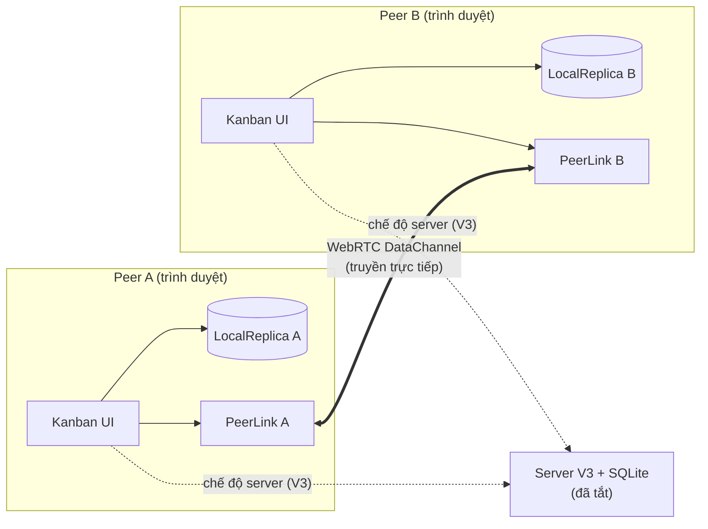
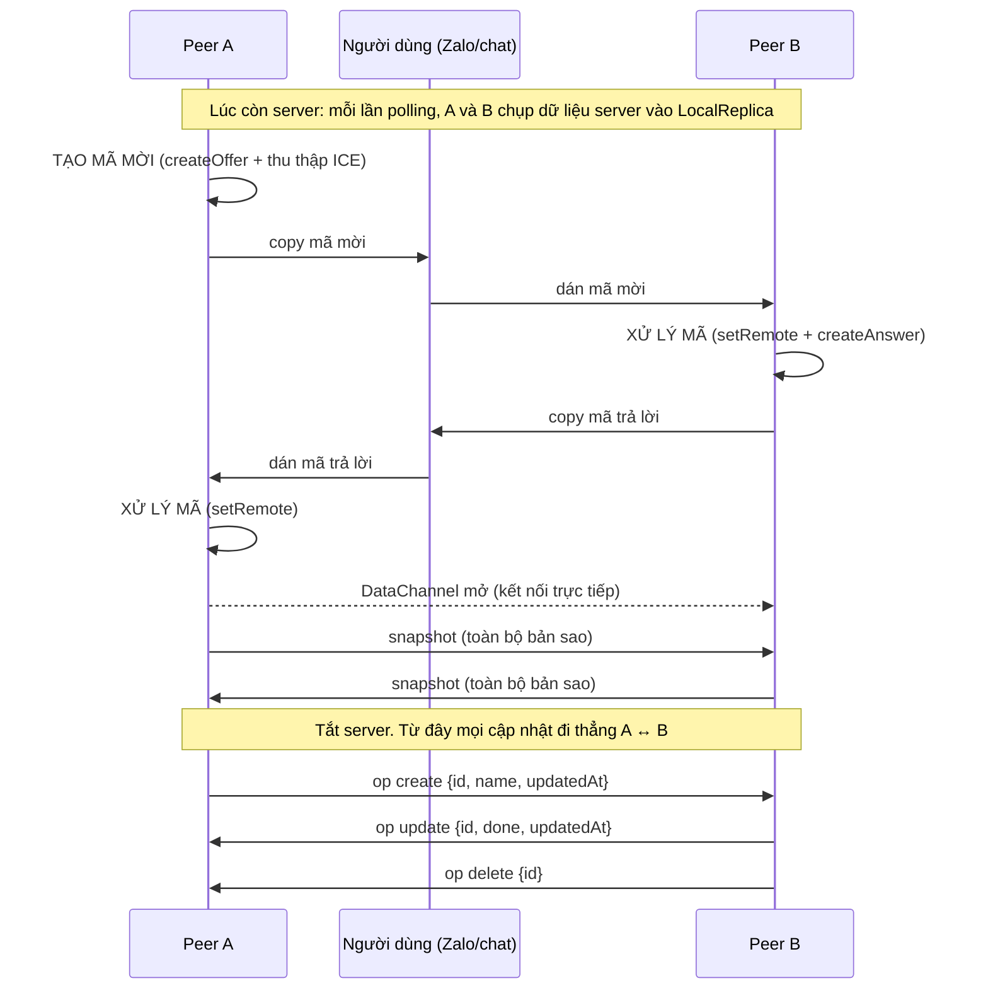

# V4 – Cộng tác P2P khi mất server

**Ràng buộc mới:** hai thành viên cùng LAN, server trung tâm không truy cập được, vẫn phải chia sẻ task và đổi trạng thái trực tiếp với nhau, không qua server trung gian.
**Hạn chế của V3:** mọi thao tác đều đi qua API server; client không giữ dữ liệu, tắt server là không làm được gì.

## Kiến trúc

V4 **không bỏ** Client–Server và 3 lớp của V3. V3 vẫn là chế độ thường (`mode = 'server'`). V4 chỉ thêm một đường đồng bộ thứ hai nằm hoàn toàn trong trình duyệt:

| Thành phần mới | File | Vai trò |
|---|---|---|
| PeerLink | `public/js/peer-link.js` | Tầng truyền: WebRTC DataChannel, signaling thủ công bằng copy-paste mã |
| LocalReplica | `public/js/local-replica.js` | Bản sao task cục bộ (localStorage), áp dụng thao tác create/update/delete, ghép bản sao |
| Bộ chuyển chế độ | `public/index.html` | Khi kênh P2P mở → chuyển sang `mode = 'p2p'`: UI Kanban đọc/ghi LocalReplica và gửi thao tác cho peer |

Server (`server.js`, `src/`) **không đổi dòng nào**.

## Luồng kết nối

Không có signaling server: mã SDP được người dùng tự chuyển cho nhau, nên sau khi kết nối không còn thành phần trung gian nào để tắt.

## Nhật ký V4

| Version | NFR mới | Quyết định thiết kế | File/thành phần đổi | Kết quả test |
|---|---|---|---|---|
| V4 | Availability khi server mất; giao tiếp ngang hàng | Giữ V3 làm chế độ thường; thêm WebRTC DataChannel với signaling thủ công; mỗi peer giữ LocalReplica; đồng bộ bằng snapshot lúc kết nối + thao tác (op) sau đó; trùng id thì bản sửa sau thắng (`updatedAt`) | Thêm `public/js/peer-link.js`, `public/js/local-replica.js`; sửa `public/index.html`. Server không đổi | Kết nối A–B, tắt server (fetch tới server thất bại); A tạo task → B nhận; B đổi trạng thái → A nhận; B xoá → A nhận |

## Đánh đổi và giới hạn

| Được | Mất |
|---|---|
| Vẫn làm việc khi server chết, miễn kênh peer còn sống | Không còn một nguồn dữ liệu chuẩn duy nhất; mỗi peer có bản riêng |
| Không cần hạ tầng mới, chạy hoàn toàn trên trình duyệt | Thay đổi lúc P2P **không ghi về SQLite**; bật lại server thì client quay về dữ liệu server |
| Độ trễ thấp (truyền thẳng) | Chỉ 2 peer; thêm người phải nối lưới nhiều kết nối |
| | Không giải quyết xung đột thật sự: hai người sửa cùng task → bản `updatedAt` lớn hơn thắng, phụ thuộc đồng hồ máy |
| | Không có tombstone: task bị xoá trước khi kết nối có thể "sống lại" khi ghép bản sao |
| | Peer mất kết nối thì thao tác không được gửi lại (không có hàng đợi) |
| | Trang phải được mở khi server còn sống; tải lại trang khi server đã tắt thì không mở được |

### Giới hạn / Chưa làm được (mã nguồn thực tế)

1. **Không có tombstone:** Thao tác xoá task chỉ đơn thuần xoá phần tử khỏi mảng trong `LocalReplica`. Khi hai peer ghép bản sao (snapshot merge), task đã bị xoá ở peer này nhưng vẫn còn ở peer kia sẽ được khôi phục trở lại ("sống lại").
2. **Cơ chế LWW phụ thuộc vào Date.now():** Quy tắc Last-Write-Wins so sánh nhãn thời gian `updatedAt` sinh ra từ đồng hồ của từng máy client (`Date.now()`). Nếu đồng hồ giữa hai máy bị lệch, máy có đồng hồ chạy nhanh hơn sẽ luôn ghi đè thay đổi của máy kia bất kể thứ tự thời gian thực tế.
3. **Chỉ hỗ trợ 2 peer:** Triển khai WebRTC hiện tại là kết nối điểm-điểm (1-1), chưa có giải pháp định tuyến dạng lưới (Mesh Network) cho nhóm từ 3 peer trở lên.
4. **Signaling thủ công:** Quá trình trao đổi thông tin kết nối (SDP Offer/Answer) hoàn toàn phụ thuộc vào việc người dùng tự sao chép và dán chuỗi ký tự qua kênh liên lạc ngoài (chat, email), chưa có cơ chế tự động tìm kiếm hay kết nối lại.

> **Lưu ý:** V4 chưa giải quyết xung đột đầy đủ.

## Trả lời câu hỏi thảo luận

1. **V2 thay đổi gì thật sự?** V1 đã có server nhưng client chỉ tải dữ liệu 1 lần. V2 cho server nghe trên LAN và client polling định kỳ, nên nhiều thiết bị cùng thấy một nguồn dữ liệu; đổi toggle thành đặt giá trị tường minh để 2 người không lật trạng thái của nhau.
2. **V3 đổi UI và DB ảnh hưởng file nào?** Đổi UI (Kanban): chỉ `public/index.html`. Đổi JSON → SQLite: `src/data/SqliteTaskRepository.js` + `scripts/migrate-to-sqlite.js` + 1 dòng khởi tạo trong `server.js`. `src/business/TaskService.js` không đổi ở cả hai trường hợp.
3. **V4 cải thiện availability khi nào, mất gì?** Khi server chết nhưng 2 máy vẫn thấy nhau trong LAN và đã kết nối từ trước. Đổi lại mất tính nhất quán mạnh: không còn nguồn dữ liệu chuẩn, có thể lệch dữ liệu, xung đột chỉ xử lý thô (last-write-wins), thay đổi không về DB.
4. **Khi nào server LAN đơn giản hợp lý hơn P2P?** Khi có nhiều hơn 2 người, cần dữ liệu nhất quán và lưu bền, cần lịch sử/sao lưu, hoặc mạng chặn WebRTC. Một máy trong LAN chạy server V3 dễ vận hành và dễ kiểm chứng hơn nhiều so với tự xử lý đồng bộ.

Để hoà giải dữ liệu đúng khi 2 người cùng sửa lúc mất kết nối cần bổ sung: đồng hồ logic (Lamport/vector clock) thay cho giờ máy, tombstone cho thao tác xoá, hàng đợi gửi lại thao tác, và lý tưởng là CRDT; khi server trở lại cần bước đẩy thay đổi P2P về SQLite.
